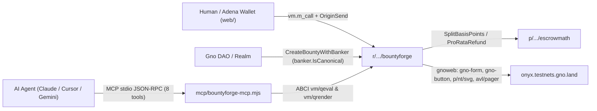

# BountyForge

**Fund a coding task, split the payout cleanly across every contributor, and mint an on-chain badge when the work ships — live on Gno.land (`onyx-1`).**

Built for the **Gnome Tavern Hackathon** on Gno `v1.8.0`, BountyForge lets sponsors lock GNOT in an escrow realm, pay multiple contributors down to the last `ugnot` with zero rounding loss, refund sponsors proportionally if work is cancelled or disputed, and issue verifiable on-chain SVG credentials via `gnoweb`, the Adena Wallet web app (`web/`), or an 8-tool AI-agent MCP server (`mcp/`).

- **HD Demo Video (Release `v2.0.0`)**: [Watch / Download `bountyforge-v2-demo.mp4`](https://github.com/LHorTL/bountyforge/releases/download/v2.0.0/bountyforge-v2-demo.mp4) (`1280x720` H.264 walkthrough: live Adena Web dApp & Split Studio, live `gnodev`/`gnoweb` v1.8.0 SVG & `<gno-form>` rendering, 60/60 test matrix & `onyx-1` receipts)
- **Live Adena Wallet Web dApp & Split Studio**: [https://lhortl.github.io/bountyforge/](https://lhortl.github.io/bountyforge/)
- **Onyx Testnet (`onyx-1`) `gnoweb` Realm**: [https://onyx.testnets.gno.land/r/g10yuqyktt4777jn8rt3nmuhw4suz9mvypaec7ac/bountyforge](https://onyx.testnets.gno.land/r/g10yuqyktt4777jn8rt3nmuhw4suz9mvypaec7ac/bountyforge)
- **Onyx GPAS Approval Tracker**: [`p/.../escrowmath`](https://gpas.onyx.testnets.gno.land/?path=gno.land/p/g10yuqyktt4777jn8rt3nmuhw4suz9mvypaec7ac/escrowmath) · [`r/.../bountyforge`](https://gpas.onyx.testnets.gno.land/?path=gno.land/r/g10yuqyktt4777jn8rt3nmuhw4suz9mvypaec7ac/bountyforge)

---

## Architecture



```text
bountyforge/
├── gnowork.toml                  # Gno workspace manifest
├── p/escrowmath/                 # Pure package: overflow-proof BPS splits, 128-bit Hamilton pro-rata refunds, GNOT/BPS math
│   ├── gnomod.toml
│   ├── escrowmath.gno
│   └── escrowmath_test.gno       # 5 test suites (dust, int64 wraparound, MinInt64, Hamilton bounds, UTF-8)
├── r/bountyforge/                # Stateful Gno escrow, dispute, DAO-banker & reputation realm
│   ├── gnomod.toml
│   ├── bountyforge.gno           # Hardened escrow state machine + canonical banker DAO entrypoints + AVL indices
│   ├── render.gno                # gnoweb UI: sanitize/v0, txlink, gno-button, mdform, mdalert, svg/v0, avl/pager
│   ├── views.gno                 # Deterministic vm/qeval JSON views for MCP & web clients
│   └── bountyforge_test.gno      # 22 security, lifecycle, injection, DAO, pagination & regression tests
├── web/                          # Zero-build static Adena Wallet Web dApp & Split Studio (GitHub Pages ready)
│   ├── index.html
│   ├── styles.css
│   ├── app.js
│   └── app.test.mjs              # Automated Node unit tests for split math, Adena payloads & XSS guards
├── mcp/bountyforge-mcp.mjs       # Zero-dep 8-tool MCP server + CLI over ABCI vm/qrender & vm/qeval
└── deploy.ps1                    # Portable Onyx testnet deployment script (auto-discovers gnokey)
```

---

## Security Invariants & Threat-Model Matrix

Every invariant below is backed by dedicated unit & regression tests in `p/escrowmath/escrowmath_test.gno` and `r/bountyforge/bountyforge_test.gno`:

| Threat Class / Vector | Mitigation Implemented | Verified By |
| :--- | :--- | :--- |
| **int64 Split Wraparound Drain** | `SplitBasisPoints` enforces `1 <= w <= 10000`, `math/overflow.Add64` running sum, strict `share > 0` (`ErrZeroShare`), `sum(shares) == total`; `releaseFunds` panics on `<= 0` | `TestSplitBasisPointsValidationAndOverflowDefense`, `Test03`, `Test04` |
| **Crowdfund Sponsor Rug-Pull** | `bounty.Contributions` ledger tracks every sponsor deposit. `CancelAndRefund` & `ExpireDispute` return exact per-sponsor deposits; `ResolveDispute` refunds pro-rata via 128-bit Hamilton `ProRataRefund` (`0 <= refund[i] <= deposit[i]`) | `TestProRataRefundExactAndBounded`, `Test05`, `Test06` |
| **Deadline Overflow Rug-Pull** | `DeadlineH` & `DeadlineH + ReviewGraceBlocks` checked via `math/overflow.Add64`; late `SubmitWork`/`TopUpBounty` blocked; `ReviewGraceBlocks` (500 blocks) prevents post-deadline stall-and-cancel | `Test09`, `Test10`, `Test11` |
| **Dead-Arbiter Permanent Lock** | `ExpireDispute` escape hatch unlocks disputes unresolved after `DisputeTimeoutBlocks` (20,000 blocks) and returns exact deposits to all contributors | `Test08` |
| **`OriginSend` TOCTOU & Foreign Coin Trap** | Direct `runtime.AssertOriginCall()` + `cur.IsCurrent()` + `cur.Previous().IsUserCall()` + strict single-denom `"ugnot"` check rejects multi-coin sends and relay calls | `Test12`, `Test13`, `Test14` |
| **DAO Banker Substitution (Threat Class 3)** | `CreateBountyWithBanker` & `TopUpBountyWithBanker` enforce `banker.IsCanonical(payerBanker)` so Gno DAOs can fund quests without trusting forged interfaces | `Test16`, `Test22` |
| **Markdown / HTML / `<gno-button>` / BiDi Injection** | Render-time slot escaping via official `gno.land/p/nt/markdown/sanitize/v0` (`InlineText`, `TableCell`, `Block`, `Blockquote`, `InlineCode`, `URL`, `BechString`) + `md.Link`; UTF-8 rune-safe truncation | `Test18`, `TestProgressBarAndUTF8SafeTruncation` |
| **Query Gas DoS & Unbounded Sort** | O(log N) AVL status indices (`OPEN`/`PAID`/`DISPUTED`/`CANCELLED`) + O(log N) sorted AVL leaderboard key (`XP DESC, Earned DESC, Addr ASC`) + clamped `avl/pager` (`<= 25/page`) | `Test19` |
| **Sybil Micro-Bounty XP Farming** | Value-weighted `ComputeXP` (`1 XP` under 0.1 GNOT, `+25 XP/GNOT` cap `2500`), `UniqueCreators` counter, and `>= 25%` dispute win threshold for completion credit | `TestFormatGNOTBPSAndTiers`, `Test07` |
| **MCP Shell Injection & SSRF** | Strict `keyName` allowlist, POSIX single-quoting (`shQuote`), base-10 BigInt/bech32 validation, and `http`/`https`-only RPC scheme validation | `bountyforge-mcp.mjs --self-test` |

---

## Key Features

- **Zero-Dust Multi-Contributor Splits (`SplitAndPay`)**: Splits any bounty across contributors with exact integer basis points summing to `10000`, guaranteed conservation of every `ugnot`, and automatic SVG split visualization on `gnoweb`.
- **Sponsor-Safe Crowdfunding (`TopUpBounty`)**: Anyone can boost an active bounty pool with full pro-rata refund protection.
- **DAO Composability (`CreateBountyWithBanker` / `TopUpBountyWithBanker`)**: Gno DAOs (`p/nt/commondao/v0`, `r/gov/dao`) can fund, top up, approve, split, and dispute bounties atomically using canonical `BankerTypeRealmSend` capabilities.
- **Gno v1.8.0 Native `gnoweb` UI**:
  - Root-relative `/r/<addr>/bountyforge:...` routing (100% compatible with `gnoweb` v1.8.0 `ext_links`).
  - Interactive `<gno-button>` CTAs powered by `p/moul/txlink/v0`, inline `<gno-form>` submission/creation via `p/jeronimoalbi/mdform/v0`, `<gno-columns>` KPI cards, `p/nt/mdalert/v0` status banners, and **on-chain SVG Builder Credential Badges** (`p/nt/svg/v0`) on `:builder/<addr>`.
  - Detects Gno v1.8.0 scoped session keys (`runtime.GetSessionInfo()`) to badge AI-agent submissions (`agent-session`).
- **Adena Wallet Web dApp & Split Studio (`web/`)**:
  - Zero-build static site (deployable directly to GitHub Pages).
  - Connects `window.adena` (`AddEstablish`, `GetAccount`, `DoContract` with `/vm.m_call`).
  - Queries live `onyx-1` ABCI RPC (`vm/qeval`, `vm/qrender`, `vm/qinertpaths`) directly; if RPC is unreachable, displays a transparent **`OFFLINE SNAPSHOT`** pill badge synced to verified `onyx-1` state (`3` bounties, `3.5 GNOT` escrowed, `2 GNOT` paid, `1` builder at `60 XP`).
  - Interactive **Split Studio** with auto-rebalancing sliders, exact BigInt dust readout, live SVG credential viewer, and one-click `gnokey` CLI fallback.
- **8-Tool AI-Agent MCP Server (`mcp/bountyforge-mcp.mjs`)**:
  - Exposes `bountyforge_render`, `bountyforge_eval`, `bountyforge_protocol_stats`, `bountyforge_list_bounties`, `bountyforge_get_bounty`, `bountyforge_leaderboard`, `bountyforge_simulate_split`, and `bountyforge_build_tx` over stdio JSON-RPC 2.0 (including `ping` and notification compliance).

---

## Running All Tests Locally

Requires Gno `v1.8.0` (`chain/onyx`) and Node.js 20+:

```bash
# 1. Run all 27 Gno package & realm unit/security tests
gno test -v ./p/escrowmath ./r/bountyforge

# 2. Run MCP server protocol, structured JSON & security self-test (26 assertions)
node mcp/bountyforge-mcp.mjs --self-test

# 3. Run Adena Web dApp split-math, payload & XSS unit tests (7 groups)
node web/app.test.mjs
```

### Launching the Adena Web dApp Locally

```bash
# Serve the static web/ directory on http://localhost:4173
npx serve web -l 4173
# or with Python:
python -m http.server 4173 --directory web
```

### MCP Client Configuration (`mcp.json`)

Add BountyForge to Claude Desktop, Cursor, or Gemini MCP settings:

```json
{
  "mcpServers": {
    "bountyforge": {
      "command": "node",
      "args": ["mcp/bountyforge-mcp.mjs"],
      "env": {
        "BOUNTYFORGE_RPC": "https://rpc.onyx.testnets.gno.land:443",
        "BOUNTYFORGE_CHAIN_ID": "onyx-1",
        "BOUNTYFORGE_REALM": "gno.land/r/g10yuqyktt4777jn8rt3nmuhw4suz9mvypaec7ac/bountyforge"
      }
    }
  }
}
```

---

## Onyx Testnet (`onyx-1`) Live Deployment & On-Chain Seeded Activity

Hardened **v2.0** is **LIVE & ENABLED** on **`onyx-1`** (`https://rpc.onyx.testnets.gno.land:443`) from `g10yuqyktt4777jn8rt3nmuhw4suz9mvypaec7ac` — both packages passed **GPAS** (`passed`, `0/2` inert) and serve live `vm/qrender`, `vm/qeval`, Adena Web dApp (`https://lhortl.github.io/bountyforge/`), and 8-tool MCP reads directly from `onyx-1`.

### 1. Deployed Package & Realm (`onyx-1`)

| Component | Package / Realm Path | v2.0 Block | v2.0 TX Hash | Gas Used | Status |
| :--- | :--- | :---: | :--- | :---: | :--- |
| Pure Package | `gno.land/p/g10yuqyktt4777jn8rt3nmuhw4suz9mvypaec7ac/escrowmath` | `#1343058` | `Q5vKAjvPz1YE+fP3BuRCyUHJ3I88EuMQL6yn8WJX9fE=` | `23,586,535` | **LIVE & ENABLED** (`onyx-1`) |
| Escrow Realm | `gno.land/r/g10yuqyktt4777jn8rt3nmuhw4suz9mvypaec7ac/bountyforge` | `#1343070` | `ZIPCxc57AfYBbfQR+C21MiCqPfnTflqeboCpNqhdyLo=` | `123,378,871` | **LIVE & ENABLED** (`onyx-1`, `vm/qrender` + `vm/qeval` active) |

*(Initial v1.0 submissions were at blocks `#1341832` / `#1341833`, superseded on-chain by the verified v2.0 replacements above.)*

### 2. Verified Live On-Chain Bounties, Settlement & SVG Builder Credential (`onyx-1`)

To let judges inspect both active escrows and a complete end-to-end payout + on-chain SVG Builder Credential (`p/nt/svg/v0`) directly on `onyx-1`, **3 real bounties** (`5.5 GNOT` total volume: `3.5 GNOT` currently escrowed across 2 open bounties + `2 GNOT` settled on-chain to builder `g1gutp6n8tllmll35w8gerze4d0lfgm5l8f88x0v`) were executed live on-chain:

| Action | Bounty / Details | Block | TX Hash | Gas Used | Live State |
| :--- | :--- | :---: | :--- | :---: | :--- |
| `CreateBounty` (#1) | *Build Onyx-1 ABCI Event Indexer & MCP Bridge* (`2 GNOT`) | `#1385748` | `X0Evg7uNlFVWM4/2Gz59uY3wDtT4c2YJJMGj44LS2aI=` | `12,566,073` | Created |
| `SubmitWork` (#1) | Builder `g1gutp6n8tllmll35w8gerze4d0lfgm5l8f88x0v` proof submission | `#1385765` | `mSURVcAioVU2r+4XpD1zefemthDIWuBMYA5pMTB4gxE=` | `12,302,407` | Submitted |
| `ApproveAndPay` (#1) | Released `2 GNOT` (`2,000,000 ugnot`), credited `60 XP`, minted SVG badge | `#1385767` | `ysdPnhrsBS9HL1Q6TKDTenAECM5ScS9oo1SNBOmWqvQ=` | `12,681,473` | **`PAID`** |
| `CreateBounty` (#2) | *Add Gno v1.8.0 Scoped Session-Key Agent CLI Support* (`2 GNOT`) | `#1385769` | `d+mdjuX9mpUB5rKtq3FVMKoaicqDfSyynbYEO4C8snU=` | `12,604,500` | **`OPEN`** |
| `CreateBounty` (#3) | *Security Audit: Canonical Banker & 128-bit Pro-Rata Refund Invariants* (`1.5 GNOT`, arbiter-protected) | `#1385771` | `7fuMOKjj0cnqSddwFLYy8P4hjr/zpFzevpShm8ZppnE=` | `13,948,848` | **`OPEN`** |

Verify live on-chain state directly via `gnokey` / ABCI RPC:
```bash
gnokey query vm/qeval -data "gno.land/r/g10yuqyktt4777jn8rt3nmuhw4suz9mvypaec7ac/bountyforge.ProtocolJSON()" -remote https://rpc.onyx.testnets.gno.land:443
gnokey query vm/qeval -data 'gno.land/r/g10yuqyktt4777jn8rt3nmuhw4suz9mvypaec7ac/bountyforge.ListBountiesJSON("", 1, 10)' -remote https://rpc.onyx.testnets.gno.land:443
gnokey query vm/qrender -data "gno.land/r/g10yuqyktt4777jn8rt3nmuhw4suz9mvypaec7ac/bountyforge:" -remote https://rpc.onyx.testnets.gno.land:443
gnokey query vm/qrender -data "gno.land/r/g10yuqyktt4777jn8rt3nmuhw4suz9mvypaec7ac/bountyforge:builder/g1gutp6n8tllmll35w8gerze4d0lfgm5l8f88x0v" -remote https://rpc.onyx.testnets.gno.land:443
```

### Live `gnoweb` Routes & Public Testnet Availability

- **Live `onyx-1` `gnoweb` Endpoints**:
  - Board: `https://onyx.testnets.gno.land/r/g10yuqyktt4777jn8rt3nmuhw4suz9mvypaec7ac/bountyforge`
  - Create Form: `https://onyx.testnets.gno.land/r/g10yuqyktt4777jn8rt3nmuhw4suz9mvypaec7ac/bountyforge:new`
  - Settled Bounty (`PAID`): `https://onyx.testnets.gno.land/r/g10yuqyktt4777jn8rt3nmuhw4suz9mvypaec7ac/bountyforge:bounty/1`
  - Open Bounties: `...:bounty/2` · `...:bounty/3` (arbiter-protected)
  - Live On-Chain SVG Builder Credential: `https://onyx.testnets.gno.land/r/g10yuqyktt4777jn8rt3nmuhw4suz9mvypaec7ac/bountyforge:builder/g1gutp6n8tllmll35w8gerze4d0lfgm5l8f88x0v`
  - Leaderboard: `https://onyx.testnets.gno.land/r/g10yuqyktt4777jn8rt3nmuhw4suz9mvypaec7ac/bountyforge:leaderboard`
  - Protocol Stats: `https://onyx.testnets.gno.land/r/g10yuqyktt4777jn8rt3nmuhw4suz9mvypaec7ac/bountyforge:stats`
- **Live Adena Web dApp (`https://lhortl.github.io/bountyforge/`)**: Automatically queries `onyx-1` ABCI RPC in live mode (`3` bounties, `3.5 GNOT` escrowed, `2 GNOT` paid, live SVG credential & Split Studio).
- **Local `gnodev local` Evaluation (Optional)**: Judges can also spin up an isolated local `gnodev` instance in seconds with Gno `v1.8.0`:
  ```bash
  gnodev local -deploy-key g10yuqyktt4777jn8rt3nmuhw4suz9mvypaec7ac \
    -add-account g10yuqyktt4777jn8rt3nmuhw4suz9mvypaec7ac=100000000000ugnot
  # Open http://127.0.0.1:8888/r/g10yuqyktt4777jn8rt3nmuhw4suz9mvypaec7ac/bountyforge
  ```

### Deploying with `deploy.ps1`

```powershell
# Auto-discovers gnokey from $PATH (or ~/.gno-tools/bin/gnokey.exe)
.\deploy.ps1 -KeyName onyx-dev -Address g10yuqyktt4777jn8rt3nmuhw4suz9mvypaec7ac
```

> Note: When deploying under a different deployer address, update `gnomod.toml` in `p/escrowmath` and `r/bountyforge` plus the `escrowmath` import path in `r/bountyforge/*.gno` before running `deploy.ps1`.

---

## License

MIT — see [LICENSE](./LICENSE).
